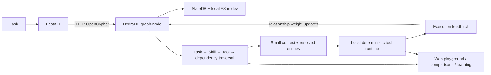

# ContextGraph

**Give agents hundreds of tools without putting hundreds of definitions in every prompt.** ContextGraph routes support tasks through a live HydraDB graph to retrieve the right skill, MCP tools, tool dependencies, and previously resolved entities.

This is a Track 2 Agent Context Layer MVP built on the open-source HydraDB engine. It is not a client for HydraDB's hosted platform. The detailed source review and actual local persistence proof are in [docs/HYDRADB_PHASE0.md](docs/HYDRADB_PHASE0.md).

## Live demo

[Open ContextGraph](https://contextgraph-demo.onrender.com). It runs on Render's Free plan and rebuilds its 100-tool demo graph after sleep or restart; first request after idle may take about a minute.

## What works

- HydraDB owns the context graph and all graph traversal and feedback updates.
- The registry contains realistic MCP tool names, descriptions, input schemas, servers, skills, dependencies, and resolved ticket/customer/order entities.
- The router reads weighted `TaskType → Skill` paths, then traverses `USES`, `DEPENDS_ON`, and `PROVIDED_BY` edges with a visited set and a four-hop dependency cap.
- A deterministic local runtime executes tools and returns traceable outputs without an LLM key.
- Full context, flat keyword retrieval, a HydraDB label-scan ablation, and HydraDB traversal share the same catalog and task fixtures.
- The feedback evaluation has distinct training and held-out prompts. It resets graph weights before each run, reports accuracy/task success/recall by iteration, and keeps evaluation tasks out of feedback updates.
- The UI shows live query paths, tool definitions, tool outputs, retrieval latency, end-to-end latency, estimated context tokens, and learning results.
- Execution, task, selected-tool, and reused-entity records are persisted in HydraDB.

## Start locally

Requirements: Rust 1.99+, a C/C++ build toolchain, SuiteSparse:GraphBLAS, `libcypher-parser`, and Python 3.10+. On macOS, the upstream project documents Homebrew setup:

```bash
brew install just cmake pkg-config llvm suite-sparse
brew install cleishm/neo4j/libcypher-parser
```

Then start the entire local stack:

```bash
./scripts/dev.sh
```

The script clones `hydra-db/hydradb` into the ignored `hydradb-upstream/` folder if missing, builds `graph-node`, starts a local filesystem object store, installs the Python environment, seeds a 100-tool catalog, and runs the initial feedback evaluation. Open [http://127.0.0.1:8000](http://127.0.0.1:8000). Press Ctrl-C to stop both processes. Data persists in `.hydradb/store`; logs are in `.hydradb/logs`.

To change the initial catalog size, set `CONTEXTGRAPH_CATALOG_SIZE=20`, `100`, or `500`. The HydraDB and API port variables can be overridden in the script. Local mode disables TLS only on loopback addresses.

## Benchmark and concurrency check

With the local stack running, run the reproducible three-size comparison (five repetitions of each fixed task and strategy):

```bash
.venv/bin/python scripts/benchmark.py
```

The script resets and seeds a 20-, 100-, then 500-tool HydraDB graph, runs the fixed feedback evaluation, executes full/flat/ablation/graph strategies, and reports task success, recall, estimated context tokens, retrieval p50/p95, and end-to-end p50/p95. Raw machine-readable output is written to `results/latest.json`.

The fresh local results and methodology are summarized in [results/BENCHMARK.md](results/BENCHMARK.md). The raw JSON is ignored by Git and can be regenerated with the command above.

Run a concurrent graph-route check:

```bash
.venv/bin/python scripts/load_test.py --requests 30 --concurrency 8 --size 500
```

Run unit tests:

```bash
.venv/bin/python -m unittest discover -s tests -v
```

Latency and token counts depend on hardware and are not production claims. Tool tokens are estimated as serialized definition characters divided by four. The deterministic fixtures execute locally and do not include network LLM latency.

## Execution modes and held-out evaluation

`POST /api/run` accepts `execution_mode: "fixture" | "agent"`; the default remains `fixture` for backward-compatible, reproducible runs. Agent mode requires `ANTHROPIC_API_KEY` on the API server (optionally set `ANTHROPIC_MODEL`, default `claude-haiku-4-5-20251001`). It sends only read-only tool definitions present in the HydraDB retrieved subgraph to Anthropic, runs a bounded tool-use loop, and executes tool calls against the local support fixtures. Write-capable tools are excluded. The hosted free demo does not receive an API key by default, so agent mode reports unavailable there until configured; provider calls can incur usage charges.

Graph entity retrieval reads ticket (`T-…`), customer (`C-…`), and order (`O-…`) IDs from the request and only returns a matching HydraDB relationship path. Unknown IDs fail closed without falling back to the demo's default entities. `GET /api/agent/status` reports availability without exposing credentials.

`POST /api/evaluate` holds out nine prompts and reports each graph and dependency-expanded lexical baseline result, tool recall, exact-entity behavior, and per-case wins and failures. The expanded-flat baseline is lexical top-k with declared dependency expansion; it is not an embedding-based semantic search baseline.

## Deployment

The container deployment path and hosted topology notes are in [docs/DEPLOYMENT.md](docs/DEPLOYMENT.md). For a local container demo, run `./scripts/compose-up.sh`. The native one-command development path remains `./scripts/dev.sh`.

The repository also includes a free Render Blueprint. It runs HydraDB and the API in one web service and reseeds demo data after each cold start; see [docs/DEPLOYMENT.md](docs/DEPLOYMENT.md) for free-tier lifecycle limits.

## Product and go-to-market

**Initial customer:** agent platform teams operating large internal MCP catalogs for support, IT, or operations workflows. They need to select compatible tools, preserve dependency order, and reuse known entities without loading every tool schema on each turn.

**Value:** fewer tool definitions and lower tool-selection failure risk for tasks with multi-step dependencies. ContextGraph fits between an agent runtime and its MCP registry; it can return a compact tool context and execution trace. A plausible initial model is a developer tier for hosted graph/context usage, then team/enterprise pricing for private catalogs, SSO, audit, policy controls, and service-level commitments. Pricing and market-size claims need customer interviews; this project does not make unsupported market estimates.

**30-second pitch:** “A large MCP catalog makes every agent prompt pay for tools the task will never use. ContextGraph keeps skills, tools, dependencies, and resolved entities in HydraDB, then traverses only the neighborhood required for the task. In this support workflow, the agent gets a small tool set, follows its dependencies, reuses its customer/order context, and completes the task without loading the full catalog.”

**Landing headline:** More tools. Smaller agent context.

**Launch post draft:** “We built ContextGraph for the MCP sprawl problem: store tool relationships in HydraDB, traverse only what a task needs, and measure context, recall, and latency against full-context and keyword baselines. The demo runs locally with deterministic tools—no API key required.”

## Architecture



The backend architecture, benchmark design, actual HydraDB constraints, and limitations are documented in [docs/HYDRADB_PHASE0.md](docs/HYDRADB_PHASE0.md). Submission and demo materials are in [docs/LAUNCH_ASSETS.md](docs/LAUNCH_ASSETS.md).

## License

ContextGraph project code is MIT licensed. HydraDB is a separate dependency and is licensed by its upstream repository under Elastic License 2.0; review both licenses before redistributing a combined image.
