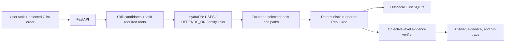

# ContextGraph frontend guide

## Product surface

The FastAPI app serves the dashboard from `web/index.html` and its native CSS and JavaScript modules from `/assets/`. This keeps the Render deployment on one existing service and does not add a separate frontend host or paid dependency.

HydraDB supplies the catalog and relationships. SQLite supplies historical order facts. The deterministic fixture runner and Real Groq agent remain separate; provider errors are shown without fixture fallback.

## Pages

- **Ask** is the first view. It frames the product around customer-support questions and shows a labeled routing schematic; the call to action opens the real interactive workflow.
- **Playground** chooses an Olist order, task, retrieval strategy, and execution mode. Results include the evaluator outcome, objective rows, selected tools, actual calls, graph paths, and trace.
- **Graph Explorer** calls `GET /api/graph/explore` for a bounded task-specific route and optional order neighborhood. It supports search, type/relationship filters, node inspection, immediate-neighbor focus, pan, zoom, and reset. The API caps output at 150 nodes, 300 relationships, and 30 order items. It does not execute tools.
- **Learning Lab** calls the fixture endpoint only when requested. The Groq button is separate and only calls the real-agent endpoint. Both demonstrate request-scoped retrieval filtering, not a persisted shared-graph mutation.
- **Tool Registry** reads the live `/api/tools` catalog and filters by skill, logical server, and provenance. Its source badges distinguish historical Olist tools, simulated demo policy, and legacy fixture-only tools.
- **Evaluations** presents the measured isolated deterministic results and their small sample size. It does not describe the figures as live telemetry or a Groq comparison.
- **Documentation** summarizes the architecture, workflow, and evidence limits in the app.

## Graph Explorer API

`GET /api/graph/explore?task=...&order_id=...` performs bounded read-only retrieval. The `task` field is required in practice (8–1200 characters); `order_id` is optional and, if present, must be a 32-character hexadecimal Olist identifier. The route starts from task-required tool roots, follows the same directional dependency edges used by the executor, includes matching actual agent/skill and order/item/product/seller relationships, and returns only catalog metadata needed for inspection. It does not return HydraDB credentials or execute any tool.

For category requests, the current relationship is `order.items -[DEPENDS_ON]-> order.details`: retrieval includes `order.details` as a prerequisite, and the deterministic executor calls `order.details` before `order.items`. A status-only request is rooted at `order.details` and does not traverse the incoming item dependency.

## Verification and limitations

Successful tool calls do not imply task success. The outcome badge and each objective are rendered from the independent answer evaluator. Context sizes are estimates based on serialized tool definitions; latencies come from returned backend metrics.

The dashboard's dependency benchmark uses three held-out orders in a fresh local HydraDB graph and deterministic Olist execution. The paired status/category controls use the same three orders. They are descriptive tests, not a statistically powered benchmark or a general learned retrieval evaluation. The controlled hosted Learning Lab does not mutate the shared graph. See [the experiment report](GRAPH_LEARNING_RESULTS.md).

The frontend uses small native CSS/JavaScript modules rather than a Vite/React build so the existing Python/Docker/Render deployment stays one-process and build-free. The optional MCP adapter is independently installable from `packages/contextgraph-mcp/`; the browser UI does not depend on it.
