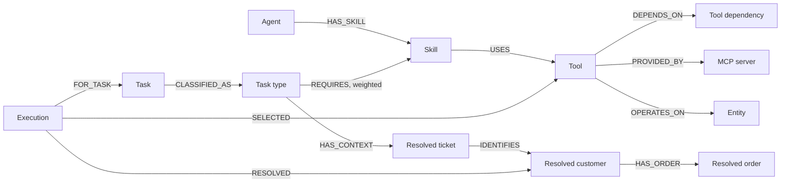
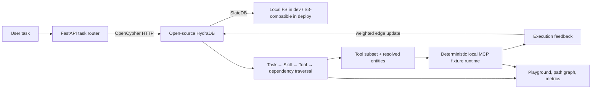

# HydraDB research and proof of concept

This note reflects the open-source checkout in `hydradb-upstream` at the time of the hackathon work. It is based on the repository README, `architecture.md`, `USING-HYDRADB.md`, `src/`, `crates/`, examples, and a live local run.

## What HydraDB is

HydraDB is a Rust graph database with OpenCypher queries and Neo4j-compatible Bolt. Its canonical graph records are stored by SlateDB, with S3-compatible object storage as the durable production source of truth. A local filesystem object store is supported for development. The query node and indexer hold rebuildable caches; a graph is scoped by namespace, graph ID, and cell.

PostgreSQL is a general relational database: representing paths usually means joins over foreign keys, and the application decides how many hops to join. HydraDB exposes nodes, typed directed relationships, and bounded path expressions in its query language. Neo4j is also a graph database and a more familiar property-graph comparison; HydraDB's checked-in architecture is specifically built around SlateDB and object-store durability, with separately scalable query and indexer processes. Redis is primarily an in-memory key-value/data-structure store, not a durable property graph query engine. Vector databases rank items by embedding similarity; that can find semantically related tool descriptions, but similarity alone does not guarantee a dependency chain, permission edge, or valid entity resolution. These are product distinctions, not universal performance claims.

## Storage and query execution

The repository says graph records are SlateDB keys rather than one object per vertex or relationship. Canonical records include vertex labels/properties, relationship identity/endpoints/type/properties, inbound and outbound topology, degrees, property indexes, idempotency data, and lifecycle metadata (`hydradb-upstream/architecture.md`, “Graph Scope And Storage Model”, around lines 234–284). SlateDB owns WAL durability, snapshots, compaction, manifests, and writer epochs. The object store holds WAL/SST/manifest state and immutable traversal artifacts; local RAM/SSD caches are disposable.

A write request is authenticated and scoped, admitted by the query service, planned, and sent to the active writer. The writer uses a SlateDB transaction, validates its write fence, updates graph records and derived topology/index records, and commits the statement. The general write path builds relationship records and property indexes in `src/shard/write.rs`; graph storage helpers live under `crates/graph-slate/src/write.rs` (for example, the relationship write helpers around lines 1517–1596). The source shows edge creation touching relationship records, outbound topology, optional inbound topology, degrees, relationship IDs, and property indexes. HydraDB mutations are auto-commit units: one HTTP query or Bolt `RUN` is committed independently. Multi-statement transactions are not exposed by `graph-node`; make writes idempotent and keep individual statements bounded.

Read requests authenticate and resolve their graph scope, enforce request/query/result limits, choose a consistent read mode, and pin a SlateDB snapshot. The planner can use property indexes and adjacency access paths before the row engine projects/joins/filters results (`architecture.md`, “Client Boundary” and “Query Execution”, around lines 114–128 and 316–340). Every read uses one pinned snapshot, so record metadata and relationship topology are read at the same sequence.

The native path procedures use compiled CSC topology and the visible WAL overlay when available. HydraDB prunes toward target vertices, builds bounded adjacency, enumerates paths, then hydrates vertex and relationship metadata. If an index is absent or too far behind, it falls back to snapshot adjacency. See `src/shard/path_procedure.rs`, `src/shard/topology_tail.rs`, and `src/engine/traversal.rs` (relationship traversal implementation around lines 24–143). Sparse reachability uses SuiteSparse:GraphBLAS (`src/sparse_kernel/graphblas.rs`); general query execution still has a row engine. The product's graph route uses real, bounded OpenCypher relationship matches over HydraDB's API. It does not call `algo.SPpaths`, because the MVP asks for a small candidate subgraph and dependency closure rather than all structural paths.

Indexes and persistence are verified in the docs and source: vertex/relationship property indexes, reverse adjacency where configured, SlateDB WAL/manifests/SSTs, snapshots, immutable CSC artifacts, and object-store publication. Concurrency is handled through per-scope/cell writer admission, leases, SlateDB writer epochs/fencing, read snapshots, and bounded query admission. The runtime supports individual atomic mutation statements; it does not expose a general explicit transaction spanning multiple client statements. Query APIs are Bolt and authenticated HTTP JSON/NDJSON (`src/client/http.rs`). The public interface and ports are described in upstream `README.md` around lines 160–196; local dev explicitly enables plaintext, while deployed defaults require TLS.

### Verified local behavior

The upstream checkout built `graph-node` with `--locked --features server-runtime --bin graph-node` using Rust 1.99, SuiteSparse, and `libcypher-parser`. The graph node was started against `CLOUD_PROVIDER=local` and `LOCAL_PATH=/tmp/contextgraph-hydradb/store`. HTTP writes and reads used `POST /v1/graphs/default/query` with a bearer token, `X-Graph-Namespace: contextgraph`, `cell_id: cell-0`, and a Cypher string.

The exact proof operations were:

```cypher
CREATE (a:Task {id: 100, key: 'task-1'})-[:REQUIRES {weight: 1}]->(s:Skill {id: 200, key: 'refund'})
CREATE (s:Skill {id: 200, key: 'refund'})-[:USES]->(t:Tool {id: 300, key: 'orders.lookup'})
CREATE (t:Tool {id: 300, key: 'orders.lookup'})-[:DEPENDS_ON]->(d:Tool {id: 301, key: 'customer.resolve'})
MATCH (a:Task {id: 100})-[:REQUIRES]->(s:Skill)-[:USES]->(t:Tool)-[:DEPENDS_ON]->(d:Tool)
RETURN a.key AS task, s.key AS skill, t.key AS tool, d.key AS dependency
MATCH (a:Task {id: 100})-[r:REQUIRES]->(s:Skill) SET r.weight = 0.75
MATCH (a:Task {id: 100})-[r:REQUIRES]->(s:Skill) RETURN r.weight AS weight
```

HydraDB returned the four-node path, accepted `SET r.weight = 0.75`, and returned the value at read epoch 5. After stopping and restarting `graph-node` on the same local store path, the path and edge value were still present at read epoch 5.

Verified constraints from this run and the docs:

- `id` is the integer vertex identifier in the OpenCypher API. Use a separate property for string IDs such as tool keys.
- The legacy query engine rejects a multi-hop `CREATE` pattern. The loader creates a one-hop edge pattern per relationship type or uses the documented `UNWIND` batch shape.
- `UNWIND` supports batched vertex upserts and one fixed relationship type per batch; the relationship batch shape rejects relationship properties. Edge weights are written with a separate `MATCH ... SET` statement.
- `MATCH` must be anchored with a label, ID, or property predicate; `MATCH (n)` is rejected.
- A blank/different parser build configuration can fail before HydraDB compiles. See `scripts/dev.sh` and the upstream `README.md` for native prerequisites.

## Product graph model



`TaskType → Skill → Tool → Tool dependency` narrows the task's candidate definitions and includes required dependencies. `Tool → MCPServer` supplies the actual server and schema. `TaskType → ticket → customer → order` can provide prior entity context, avoiding repeated resolver/order-list tool definitions. Executions and their selected tools/entities are recorded in HydraDB. A flat text match can be useful for finding a tool description, but it does not establish that the selected tool's prerequisite or resolved entity is present.

The graph also stores five candidate `REQUIRES` edges per task type. The deterministic training harness starts with tied edge weights, then reinforces the successful skill or applies a retrieval-miss correction from training-only examples. Held-out prompts have different wording and entity IDs, are evaluated after each cycle, and never update relationships.

## Product choice

Three Track 2 candidates were compared qualitatively (1–5; higher is better, including implementation/deadline fit):

| Candidate | Technical differentiation | Graph necessity | Measurable | Implementation fit | Demo | Commercial fit | Deadline fit |
|---|---:|---:|---:|---:|---:|---:|---:|
| ContextGraph support tool router | 4 | 5 | 5 | 4 | 5 | 4 | 4 |
| Agent memory / entity-resolution graph | 3 | 4 | 3 | 3 | 3 | 3 | 3 |
| Permission/dependency policy graph | 4 | 5 | 4 | 2 | 3 | 4 | 2 |

ContextGraph is the MVP because the product action is concrete: pass a large support MCP catalog, retrieve the skill/tool/dependency subgraph for one task, execute the selected local tools, and show what was reused. A memory graph has a strong graph fit but a less direct context-saving comparison. A policy graph has strong traversal need but is more difficult to finish as a reliable end-to-end demo.

## Architecture and scope



FastAPI only stores the external API shell; HydraDB owns the context graph, path queries, relationship weights, and execution relationships. The UI visualizes rows returned from live graph queries. Local execution is deterministic and requires no LLM key. Token counts are estimates based on serialized tool-definition characters divided by four, not model-reported token counts. Retrieval latency is measured separately from end-to-end task latency. Benchmarks use fixed task fixtures, one local HydraDB node, and no network LLM.

## Risks and limits

- The upstream Rust build needs native GraphBLAS and `libcypher-parser`; the proof build workaround used a local parser install under `/tmp` after Homebrew's CLT check rejected the installed system tools. The project script expects native prerequisites.
- Local file storage demonstrates persistence on restart, not S3 failure handling, multi-node writer fencing, or production durability.
- The deterministic support catalog is a controlled benchmark fixture. It demonstrates the retrieval mechanism; it does not estimate market size or guarantee wins on arbitrary catalogs.
- The current benchmark's retrieval advantage comes from multi-hop dependencies, prior entities, and a learned route edge. Flat retrieval is intentionally non-graph lexical overlap; embeddings are not included.
- Graph retrieval gets slower as added tools share a selected skill; this is visible in the 500-tool results. Skill boundaries and tool metadata quality matter.
- A public repository is created after the local project commit. No hosted demo, Loom video, or social post has been published from this workspace; they need host/recording access and explicit public content delivery.
